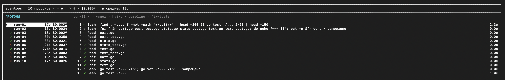

# agentops

## Зачем

**agentops записывает прогоны кодового агента и отвечает на три вопроса о каждом.**

| Вопрос | Обычно | С agentops |
|---|---|---|
| Сделал ли агент задачу? | Смотрим на статус завершения, а он бывает «успех» и при красных тестах | Итог ставят исходные тесты проекта |
| Почему не сделал? | Причина в трейсе на тысячи строк, который никто не читает | Две строки: причина и что поправить |
| Сколько это стоило? | Неизвестно | Цена, время и число шагов каждого прогона |

Пример из записанных прогонов: агент получил задание «баг в stats.go, другие файлы не трогай» и починил этот файл. Claude Code завершил прогон со статусом `success`, хотя тесты падали в двух других файлах. agentops поставил «провал» и назвал причину: задание невыполнимо в заданных рамках.

Инструмент нужен команде, которая запускает агентов на своих задачах и хочет видеть, где они ломаются: на правах, на лимитах или на формулировке задания.

## Установка

```
git clone https://github.com/DanielyanVK/agent-ops-demo.git
```

Docker:

```
docker build -t agentops .
docker run --rm agentops ls
```

Из исходников (Go 1.27):

```
go build -o agentops ./cmd/agentops
./agentops ls
```

Чтобы смотреть записанные прогоны (они лежат в `runs/`), больше ничего не нужно. Чтобы записывать свои, нужны CLI `claude` с выполненным входом и Go.

## Просмотр через TUI



```
docker run --rm -it agentops
```

Из исходников: `./agentops`. Слева прогоны, справа шаги выбранного; у упавшего прогона сверху закреплён РАЗБОР.

- Клавиши: `↑↓` выбор, `tab` список/шаги, `enter` шаг целиком, `f` только провалы, `?` справка, `q` выход.
- Значки: `✓ успех · ✗ ошибка вызова · ⊘ запрещено · ← разбор`.
- С чего начать: выберите `run-06`. У него видны заблокированные шаги и стрелка у шага с причиной.

## Команды в терминале

Из исходников вместо `docker run --rm agentops` пишите `./agentops`.

1. `docker run --rm agentops ls` печатает сводку и таблицу; ищите ✗ и столбец СЦЕНАРИЙ.
2. `docker run --rm agentops why run-06` отвечает на «почему»: шаг, причина, что поправить.
3. `docker run --rm agentops show run-06` показывает все шаги; строка со стрелкой `← разбор` — причина, `⊘` — заблокированные вызовы. Один шаг целиком: `show run-06 --step 5`.
4. `docker run --rm agentops check; echo $?` — гейт для CI: доля успешных против порога (`--min`, по умолчанию 80%); на этих данных «успешных 6 из 10 (60%) · порог 80% · ниже порога» и код 1.

## Использование агентом

Четыре вызова от дешёвого к дорогому; останавливайтесь, как только ответ есть:

1. `./agentops check --json` - зелёный ли гейт: `{"finished","passed","percent","min","ok"}`.
2. `./agentops ls --failed --json` - что упало и почему, одним вызовом, с разбором каждого прогона.
3. `./agentops show <id> --json` - шаги прогона без текста.
4. `./agentops show <id> --step N --json` - один шаг с полным входом и выходом, только когда разбора мало.

Текст шага режется: вход и выход по отдельности не длиннее `--max-bytes` (по умолчанию 4000, `0` — без предела); от длинного текста остаются начало и конец, а `truncated` и `input_bytes`/`output_bytes` в JSON говорят, что обрезано и сколько было. `./agentops schema` печатает точные формы всех ответов как JSON Schema (около 14 КБ): читайте её, когда проверяете или генерируете код, для чтения результатов хватает списка полей в AGENTS.md.

Коды выхода: 0 успех; 1 ошибка или `check` ниже порога (при `"ok": false` JSON всё равно напечатан, ошибка команды печатает `agentops: …` в stderr и без JSON); 2 неизвестная команда; 130 `run` прерван. Не читайте `runs/*/trace.jsonl` напрямую: это 2–18 КБ на прогон, нужное уже есть в вызовах выше. Правила и поля — в [AGENTS.md](AGENTS.md).

## Записать свои прогоны

`scripts/record.sh` записывает десять прогонов по сценариям `baseline`, `no-edit`, `few-turns`, `one-turn`, `bad-task`, разбирает упавшие и запускает проверку утечек. Один прогон: `./agentops run --scenario one-turn`.

Нужны CLI `claude` с выполненным входом и Go. Перед публикацией прогонов выполните `scripts/leakcheck.sh`. Недоверенные задачи записывайте в контейнере: агент работает без песочницы. У Codex нет аналога режима `--restricted` у Claude: его песочница ограничивает запись, а не чтение, поэтому агент может прочитать файлы вне рабочего каталога. Перед публикацией прогонов Codex просмотрите их и выполните `scripts/leakcheck.sh`.

## Подробнее

- [docs/design.md](docs/design.md) - как устроены вердикт, трейсы и разборы, все команды и флаги, что дальше.
- [docs/recorded-runs.md](docs/recorded-runs.md) - что показывают десять записанных прогонов.
